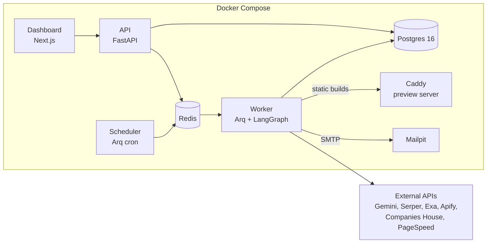

# Leads System

A lead-generation and outreach pipeline for a small web design agency. It finds US and UK
businesses that need a logo, a website, a redesign or SEO work, checks that they are a real fit,
finds a verified way to contact them, audits their current site, drafts logo concepts and a
website preview, and writes a personalised email that a person approves before it is sent.

Everything runs locally with Docker Compose. The default configuration uses free-tier APIs
only and delivers every email to a local Mailpit inbox, so nothing leaves the machine until
you switch to a real email provider.

Setup, day-to-day operation, configuration and troubleshooting are in the [runbook](docs/RUNBOOK.md).

## Features

- **Discovery** from licensed search APIs (Serper, Exa), public social posts via Apify (X,
  Instagram, Facebook public pages and groups, Reddit), Companies House, freelance boards and
  alert emails, plus proactive triggers for broken or outdated local business sites.
- **Qualification**: intent scoring (LLM for explicit requests plus rule-based signals),
  country, language and time-zone detection, duplicate matching and cooldowns.
- **Contact enrichment** from the lead's own post, the business website or a public social
  bio. Addresses are verified (syntax + MX) and never guessed.
- **Website audit**: Playwright screenshots, axe-core, PageSpeed/Lighthouse lab data,
  technical SEO, security headers and a short vision review. Every finding links to stored
  evidence, and a PDF report is generated for the client.
- **Branding**: colours, fonts and logo extracted from the existing site, and three SVG logo
  concepts generated by the LLM. Concepts are sanitised, rendered to PNG and compared with
  competitor logos.
- **Website preview**: a template filled with verified facts and rendered to static HTML
  (the template is compiled once, each preview takes about a second), tested (smoke test,
  links, Lighthouse) and served privately by Caddy.
- **Quality check** on logos, previews and evidence links before anything is used.
- **Proposals and outreach**: evidence-backed claims, React Email templates in four
  languages, an approval queue, business-hours sending windows, follow-ups, reply
  classification, unsubscribe links and a permanent suppression list.
- **Policy layer in plain code**: budget and free-tier caps, country rules, send limits,
  suppression, one active outreach per business, and restricted actions that are never
  automated.
- **Dashboard** for leads, audits, previews, approvals, inbox and deals, sources, weekly
  reports, system health and settings.
- **Learning loop**: a weekly report and small, logged adjustments to scoring weights once
  there is enough data.

## Architecture



Each lead moves through per-lead LangGraph workflows in two lanes. Every step is recorded in
`agent_runs`, so a failed or interrupted lead resumes at the first unfinished step.

```
Discovery            sources and proactive triggers create leads with evidence
Fast lane (every lead, target under 3 minutes)
  Prefilter          plain rules: sellers, stale posts, repeats, non-target countries
  Requirements       batch LLM scoring (many leads per call), brief, locale, gates
  Contact            verified email or contact form; no route means the lead stops here
  Light audit        static SEO/security/outdated-site checks and cached PageSpeed
  Proposal           text-only draft with evidence-mapped claims
Heavy lane (the day's best leads, or on request; target under 10 minutes)
  Audit + Branding   full audit (screenshots, vision review, competitors, PDF) and three
                     SVG logo concepts, side by side
  Website            template filled from facts, rendered and tested as a private preview
  Quality check      logos, preview and evidence links; failures go back once, then to a person
  Proposal           redrafted with the assets attached
(approval)           a person approves, edits or rejects in the dashboard
Outreach             policy gate, sending window, follow-ups, replies to the inbox
```


